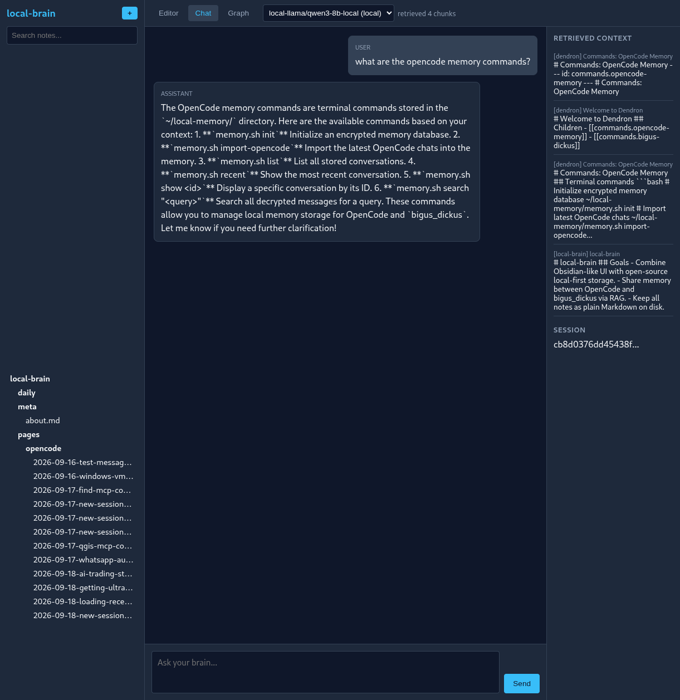

# local-brain

A private, local-first knowledge brain: a Markdown vault with hybrid semantic
search, a desktop editor, and an MCP server so AI tools can query it — running
entirely on your own machine, with nothing sent to a third party.



## Why

Most "second brain" tools want your notes on someone else's server. This one
does not. Notes stay as plain Markdown files you own and can read with `cat`.
Search runs against a local SQLite file with FTS5 full-text search and
sqlite-vec vector similarity, so it works offline and keeps working if the
provider disappears. Embeddings are computed locally with `fastembed` (or
Ollama, if you prefer a local model).

The MCP server is the point of the project: it exposes the same retrieval to
AI coding tools, so an assistant can pull in the notes and context you actually
care about instead of a generic model's guesses.

## What it does

- **Markdown vault** — notes as plain `.md` files with frontmatter, tags,
  backlinks and a D3 force-directed graph view.
- **Hybrid search** — SQLite FTS5 for keywords plus sqlite-vec for semantic
  similarity, ranked together. `/api/rag/search` and `/api/search`.
- **Desktop shell** — PySide6 window with a QWebEngineView host for the web UI.
- **WYSIWYG editor** — Milkdown-based Markdown editing, so the vault is
  writable without leaving the app.
- **MCP server** — `search_memory`, `recent_context` and `index_memory`
  exposed over the Model Context Protocol.
- **Integrations** — CalDAV calendar, Logseq note ingestion, Obsidian-style
  backlinks, plus a small leads tracker, job tracker and todo store.
- **OpenCode chat ingestion** — index your AI coding sessions back into the
  vault so your own history becomes searchable memory.

## Stack

| Layer | Choice |
|---|---|
| Backend | FastAPI, uvicorn (37 REST endpoints) |
| Desktop shell | PySide6 + QWebEngineView |
| Editor | Milkdown (WYSIWYG Markdown) |
| Graph view | D3.js force-directed |
| Storage | Markdown files on disk + one SQLite file |
| Search | SQLite FTS5 + sqlite-vec vector similarity |
| Embeddings | fastembed (`all-MiniLM-L6-v2`, ~90 MB), Ollama optional |
| AI integration | MCP (Model Context Protocol) server |

## Quick start

```bash
git clone https://github.com/ksohos333/local-brain.git
cd local-brain

python3 -m venv .venv
source .venv/bin/activate
pip install -r requirements.txt

bash run.sh
```

Then open <http://127.0.0.1:9876> for the web UI, or launch the desktop shell:

```bash
python desktop.py
```

The first run creates the database at `~/.local/share/local-brain/brain.db` and
downloads the embedding model. After that, everything is offline.

## Architecture

```text
local-brain/
├── local_brain/
│   ├── main.py          # FastAPI app — notes, search, graph, chat, calendar
│   ├── rag.py           # Hybrid retrieval: SQLite FTS5 + sqlite-vec
│   ├── embeddings.py    # fastembed / Ollama embedders
│   ├── vault.py         # Markdown read/write, frontmatter, backlinks
│   ├── chat.py          # Chat proxy over local / hosted models
│   ├── ingest.py        # Ingest external notes and chat transcripts
│   ├── apps.py          # App registry exposed via /api/apps
│   ├── caldav.py        # CalDAV calendar sync
│   ├── logseq.py        # Logseq note ingestion
│   ├── jobs.py          # Job tracker
│   ├── leads.py         # Leads tracker
│   ├── termart.py       # Terminal art helpers
│   ├── config.py        # Configuration
│   └── static/          # Web UI — index.html, app.js, style.css
├── mcp_rag_server.py    # MCP server bridging AI tools to the brain
├── desktop.py           # PySide6 desktop shell
├── run.sh               # Launch uvicorn on 127.0.0.1:9876
├── start_server.py      # Start the server as a detached daemon
└── migrate_pg_to_sqlite.py  # One-off migration from the Postgres backend
```

## API

A selection of the 37 endpoints:

| Method | Path | Purpose |
|---|---|---|
| `GET` | `/api/notes` | List notes in the vault |
| `GET` | `/api/notes/{path}` | Read a single note |
| `POST` | `/api/notes` | Create or update a note |
| `GET` | `/api/search` | Keyword + semantic search |
| `GET` | `/api/rag/search` | Hybrid RAG retrieval |
| `GET` | `/api/rag/recent` | Recently indexed content |
| `POST` | `/api/rag/index` | Index content into the vault |
| `POST` | `/api/rag/reindex-vault` | Rebuild the whole index |
| `GET` | `/api/graph` | Link graph for the D3 view |
| `GET` | `/api/backlinks/{path}` | Backlinks for a note |
| `POST` | `/api/chat` | Chat over the local brain |
| `GET` | `/api/calendar/events` | CalDAV calendar events |
| `GET` | `/api/leads`, `/api/jobs`, `/api/todos` | Tracker data |

Full list: `http://127.0.0.1:9876/docs` (FastAPI auto-generated OpenAPI UI).

## MCP server

`mcp_rag_server.py` exposes the brain to AI coding tools over the Model Context
Protocol. It talks to the local server over HTTP, so the MCP server and the
brain can run as separate processes.

```bash
source .venv/bin/activate
python mcp_rag_server.py
```

Tools exposed:

| Tool | Purpose |
|---|---|
| `search_memory` | Hybrid semantic + keyword search over the vault |
| `recent_context` | Most recently indexed content for a session |
| `index_memory` | Index new content into the vault |

Example client configuration:

```json
{
  "mcpServers": {
    "local-brain": {
      "command": "python",
      "args": ["/path/to/local-brain/mcp_rag_server.py"],
      "env": { "LOCAL_BRAIN_URL": "http://127.0.0.1:9876" }
    }
  }
}
```

## Development

```bash
source .venv/bin/activate
uvicorn local_brain.main:app --reload --port 9876
```

The vault location, embedding model and MCP endpoint are all configurable in
`local_brain/config.py`.

## Status

Actively developed. The Postgres + pgvector backend was replaced by SQLite with
`sqlite-vec` and FTS5, which removed the container dependency and made the
whole thing single-file; `migrate_pg_to_sqlite.py` handles moving an existing
vault across.

## License

MIT — see [LICENSE](LICENSE).
